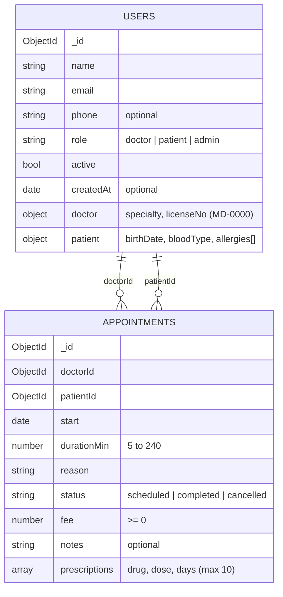

# 🏥 Clinic — MongoDB Deep Dive


A hands-on MongoDB lab built around a small clinic: doctors, patients and their appointments.
It covers the full path from a locked-down server to relational queries:
**authentication → roles → schema validation → seed data → CRUD → `$lookup`**.

Every file is a self-contained lab report: the commands, the account they run as,
and the actual result recorded as a comment right below each command.

---

## 📂 Project structure

| File | Topic | What it covers |
|---|---|---|
| [`01_auth.mongodb`](01_auth.mongodb) | **Authentication** | Open server → first admin → enabling `authorization` → SCRAM-SHA-1 vs SCRAM-SHA-256 users, the mechanism grid, wrong `authSource` |
| [`02_roles.mongodb`](02_roles.mongodb) | **Roles & permissions** | Custom `frontdesk` role, three app accounts, predicted vs. actual permission matrix |
| [`03_validators.mongodb`](03_validators.mongodb) | **Schema validation** | `$jsonSchema` with role-dependent `oneOf`, `$expr` cross-field rule, 10 rejected documents, `moderate`/`warn` migration |
| [`04_seed.mongodb`](04_seed.mongodb) | **Seed data** | Re-runnable seed: 9 users and 9 appointments, ids captured from `insertMany`, never typed by hand |
| [`05_crud.mongodb`](05_crud.mongodb) | **CRUD** | 10 reads, 7 updates (incl. `$addToSet`, upsert, a forced validation failure), 3 deletes |
| [`06_lookup.mongodb`](06_lookup.mongodb) | **Relations** | 6 aggregation pipelines with `$lookup` + a bonus check for broken references |
| [`mongod_lab.conf`](mongod_lab.conf) | **Server config** | Lab `mongod` on port `27019`, localhost only, authorization enabled |

---

## 🗂️ Data model

Doctors, patients and admins live together in one `users` collection, distinguished by `role`.
Appointments reference two users: a doctor and a patient.



### Validation rules highlights

- **Role-dependent shape** via `oneOf`: a `doctor` must have a `doctor {}` subdocument and no `patient {}`, a `patient` the opposite, an `admin` neither.
- **Strict documents**: `additionalProperties: false` (with `_id` listed explicitly, otherwise every document would be rejected).
- **Cross-field rule**: `$jsonSchema` cannot compare two fields, so it is combined with `$expr: { $ne: ["$doctorId", "$patientId"] }`.
- **Formats**: email and phone patterns, license number `^MD-\d{4}$`, blood type enum, unique allergies.

---

## 🔐 Security setup

### Authentication mechanisms

Two users, each created with a single SCRAM mechanism, connected three ways:

| Connect as | no `authMechanism` | `SCRAM-SHA-1` | `SCRAM-SHA-256` |
|---|:-:|:-:|:-:|
| `mechSha1` | ✅ | ✅ | ❌ Authentication failed |
| `mechSha256` | ✅ | ❌ Authentication failed | ✅ |

Connecting `mechSha256` with `authSource=admin` fails with `UserNotFound`: users live in the database they were created in.

### Permission matrix

| Operation | `clinicApp`<br>readWrite | `auditor`<br>read | `reception`<br>frontdesk | `labAdmin`<br>readWriteAnyDatabase |
|---|:-:|:-:|:-:|:-:|
| A · find a user | ✅ | ✅ | ✅ | ✅ |
| B · insert an appointment | ✅ | ❌ | ✅ | ✅ |
| C · update a phone | ✅ | ❌ | ✅ | ✅ |
| D · delete an appointment | ✅ | ❌ | ❌ | ✅ |
| E · create an index | ✅ | ❌ | ❌ | ✅ |
| F · list collections | ✅ | ✅ | ❌ | ✅ |

`frontdesk` is a custom role with only `find`, `insert` and `update` on `users` and `appointments`.
The matrix was predicted **before** running the operations; the two surprises (E and F for `reception`)
show that `createIndex` and `listCollections` are separate actions that the role does not grant.

---

## 🚀 Getting started

### Requirements

- [MongoDB Community Server](https://www.mongodb.com/try/download/community) 8.x (`mongod`)
- [VS Code](https://code.visualstudio.com/) with the [MongoDB for VS Code](https://marketplace.visualstudio.com/items?itemName=mongodb.mongodb-vscode) extension. The `.mongodb` files are Playgrounds

### 1. Start the lab server

`data/` and `logs/` are not in the repository, so create them first.
Update `dbPath` and `path` in `mongod_lab.conf` to point to your clone.

```bash
mkdir -p data/lab logs
mongod --config mongod_lab.conf
```

> **Note:** to create the very first admin user (step 3 of `01_auth`), start with
> the `security` section commented out, then enable it and restart `mongod`.

### 2. Create saved connections

| Name | Connection string |
|---|---|
| `lab-open` | `mongodb://localhost:27019` |
| `lab-admin` | `mongodb://labAdmin:<password>@localhost:27019/?authSource=admin` |
| `lab-app` | `mongodb://clinicApp:<password>@localhost:27019/?authSource=clinic` |
| `lab-auditor` | `mongodb://auditor:<password>@localhost:27019/?authSource=clinic` |
| `lab-reception` | `mongodb://reception:<password>@localhost:27019/?authSource=clinic` |

### 3. Run the playgrounds in order

```text
01_auth  →  02_roles  →  03_validators  →  04_seed  →  05_crud  →  06_lookup
```

Each block starts with a `RUN WITH:` comment that names the connection it needs.
`03`–`06` run entirely as `lab-admin`, and `04_seed` resets the data, so `05` and `06`
can be re-run at any time from a clean state.

> 🔑 Passwords in this repository are replaced with `<password>`. Choose your own.

---

## 🔎 Query examples

<details>
<summary><b>R4 · Patients allergic to penicillin</b> (value inside an array in a subdocument)</summary>

```js
db.users.find({ role: "patient", "patient.allergies": "penicillin" })
```
</details>

<details>
<summary><b>U3 · Add an allergy without duplicates</b> (run twice, second time modifies nothing)</summary>

```js
db.users.updateOne(
  { name: "Ben Okoye" },
  { $addToSet: { "patient.allergies": "latex" } }
)
```
</details>

<details>
<summary><b>L2 · Every doctor with the number of appointments, including 0</b></summary>

Starting from `users` instead of `appointments` keeps doctors who have no appointments:
`$lookup` returns an empty array and `$size` turns it into `0`.

```js
db.users.aggregate([
  { $match: { role: "doctor" } },
  { $lookup: {
      from: "appointments",
      localField: "_id",
      foreignField: "doctorId",
      as: "appointments"
  } },
  { $project: { _id: 0, doctor: "$name", appointments: { $size: "$appointments" } } },
  { $sort: { appointments: -1, doctor: 1 } }
])
```
</details>

<details>
<summary><b>L7 · Bonus: find appointments whose “doctor” is not a doctor</b></summary>

A validator only sees the document being written and MongoDB has no foreign keys,
so a `doctorId` can point to a patient. `$lookup` + a role check finds such records.
</details>

---

## 💡 Key takeaways

- **`authSource` matters**: a user exists only in the database where it was created.
- **Built-in roles are coarse**: custom roles grant exact actions, and `createIndex` / `listCollections` are separate privileges.
- **Validators protect shape, not relations**: they cannot check what an `ObjectId` refers to.
- **`moderate` + `warn`** lets you introduce a validator on existing dirty data without breaking writes.
- **Start `$lookup` from the side you must not lose**: that is how “0 appointments” rows survive.

---

## 👤 Author

**Sergey Israelyan**: MongoDB Deep Dive Assignment, 2026
